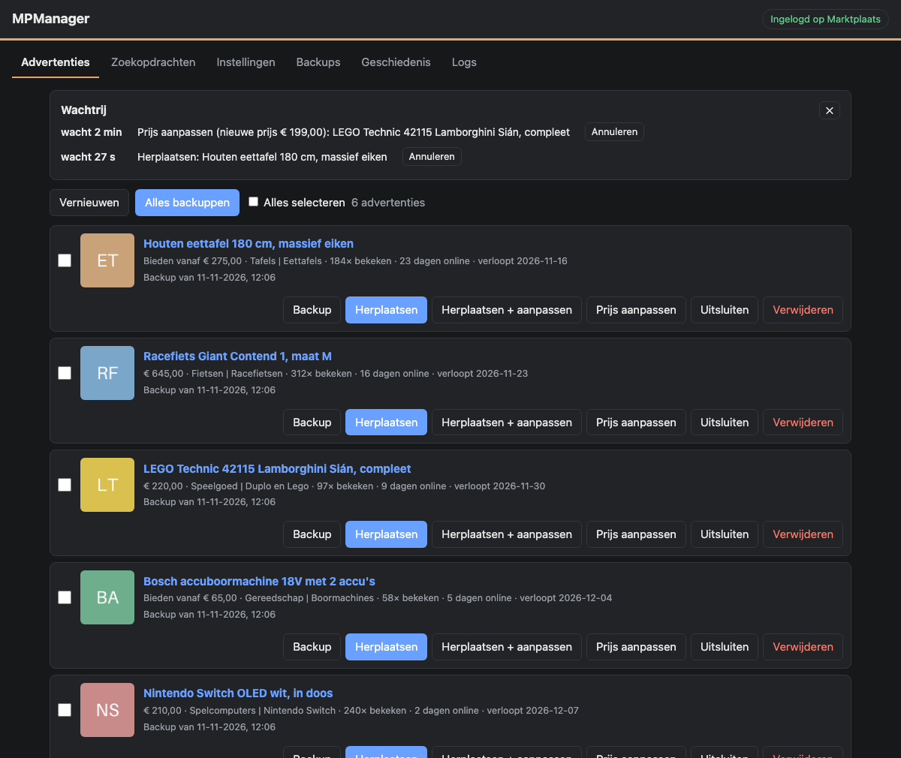
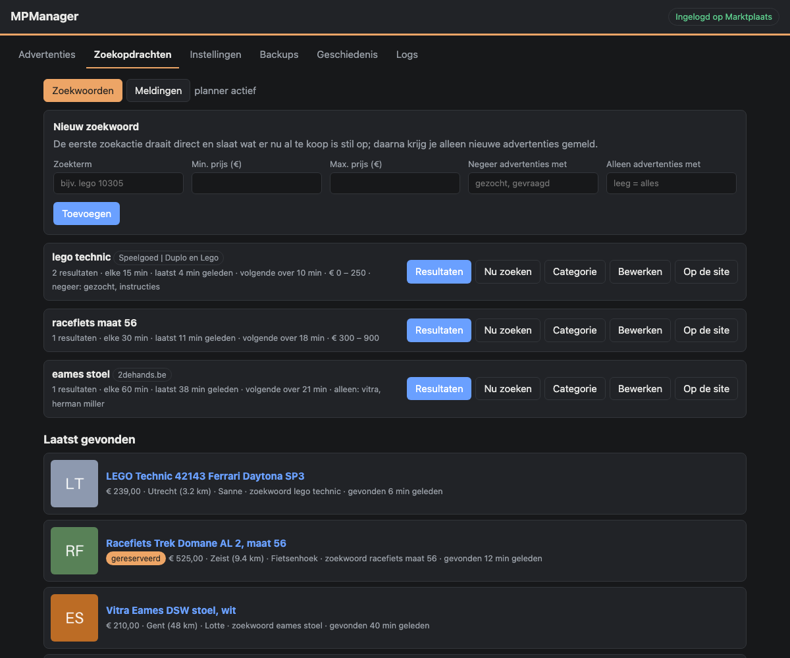

# MPManager

Een webpagina in Docker waarmee je je advertenties op Marktplaats of 2dehands
bekijkt, backupt, opnieuw plaatst en van prijs verandert, en waarmee je
zoekopdrachten in de gaten houdt. Werkt volledig met gewone HTTP-verzoeken:
geen browser, geen Playwright.





*(demo-gegevens)* Meer: [instellingen](screenshots/instellingen.png).

## Aan de slag

### 1. Drie mappen op je NAS

Eén voor de login en instellingen, één voor de backups, één voor de sleutel:

```
/share/CACHEDEV1_DATA/Docker/mpmanager/config
/share/CACHEDEV1_DATA/Docker/mpmanager/backups
/share/CACHEDEV1_DATA/Docker/mpmanager/keys
```

### 2. Start de container

In Portainer: *Stacks* → *Add stack* → *Web editor*, en plak `docker-compose.yml`
uit deze repo. De korte versie, met alles wat je moet aanpassen:

```yaml
version: "3"

services:
  mpmanager:
    container_name: mpmanager
    image: ghcr.io/terrorsource/mpmanager:latest
    init: true
    restart: unless-stopped
    network_mode: bridge
    environment:
      - TZ=Europe/Amsterdam
      - PUID=1000                         # draai als deze gebruiker, zodat de bestanden van jou zijn
      - PGID=1000
      - WEB_USER=gebruikersnaam           # login voor de pagina: wijzig beide
      - WEB_PASSWORD=password             # deze voorbeeldwaarde wordt geweigerd
      - DRY_RUN=true                      # alleen de beginwaarde; daarna geldt Instellingen
    ports:
      - 8096:8080
    volumes:
      - /share/CACHEDEV1_DATA/Docker/mpmanager/config:/config
      - /share/CACHEDEV1_DATA/Docker/mpmanager/backups:/data/backups
      - /share/CACHEDEV1_DATA/Docker/mpmanager/keys:/keys
```

- `WEB_USER` / `WEB_PASSWORD`: de pagina kan je advertenties verwijderen en je
  typt er je Marktplaats-wachtwoord in, dus kies iets echts. Staat het
  wachtwoord nog op `password`, dan toont de pagina een melding en komt niemand
  binnen. Laat je `WEB_PASSWORD` helemaal weg, dan heeft de pagina geen login.
- `PUID` / `PGID`: de gebruiker waaronder de container draait, zodat de
  bestanden op de NAS van jou zijn. Laat beide weg om als root te draaien.
- De drie mappen: die uit stap 1. Gebruik geen map die een cloud-dienst
  (OneDrive, Dropbox, iCloud) "op aanvraag" synchroniseert: zo'n dienst kan
  bestanden naar de cloud verplaatsen, en dan kan de container ze niet lezen.

De volledige `docker-compose.yml` bevat ook de beginwaarden van alle
instellingen (daglimiet, actieve uren, enzovoort). Die pas je later op de
pagina aan, dus weglaten kan.

Deploy en open `http://<nas-ip>:8096`. Het is een gewone inlogpagina, dus je
browser of wachtwoordmanager kan hem onthouden.

Zonder Portainer: zet `docker-compose.yml` in een map en draai
`docker compose up -d`.

### 3. Log in op Marktplaats of 2dehands

Bij **Instellingen** kies je de site (Marktplaats.nl of 2dehands.be) en log je
in met je e-mailadres en wachtwoord. Heb je sms-verificatie aan staan, dan
vraagt de pagina daarna om de code. De sessie die eruit komt blijft maanden
geldig. De tool werkt met één account tegelijk; opnieuw inloggen op de andere
site wisselt.

Vink *Wachtwoord versleuteld bewaren* aan als de tool zelf opnieuw moet inloggen
wanneer de sessie verloopt. Vraagt de site dan om een sms-code, dan moet je
toch even zelf inloggen. De sms-code wordt nooit bewaard.

Lukt inloggen niet, dan kun je onder "Cookies uit je browser plakken" de cookies
`MpSecurity` en `MpSslSecurity` van de site invullen.

### 4. Eerst proef, dan echt

De container start in **proefmodus**: Herplaatsen en Verwijderen tonen in de log
wat ze zouden doen en veranderen niets. Ziet dat er goed uit, zet dan
*Proefmodus* uit bij Instellingen. Herplaatst wordt daarna alleen wat je
aanklikt, tenzij je automatisch herplaatsen aanzet.

## Wat er op schijf staat

In `config`:

| Bestand | Inhoud |
|---|---|
| `state.json` | de login (sessie, eventueel wachtwoord, Telegram-token), versleuteld |
| `mpmanager.json` | alle instellingen, ook die van de zoekopdrachten |
| `queue.json` | de wachtrij, zodat een wachtende opdracht een herstart overleeft |
| `mpmanager.log` | het log van het tabblad Logs (tot 1 MB, daarna één oud bestand) |
| `history.json` | de geschiedenis |
| `watcher.db` | zoekwoorden, gevonden advertenties en het meldingenlog |

Sessie en wachtwoord staan samen versleuteld in `config/state.json`. De sleutel
staat bewust ergens anders: in de map `keys`, of in `SECRET_KEY` als je die zelf
zet. Een kopie van de map `config` alleen (een backup, een cloud-sync) is dus
niet genoeg om de login te lezen; neem `keys` daarom niet in dezelfde backup
mee. Wie volledige toegang tot de machine heeft, kan de login wel lezen. Raakt
de sleutel kwijt, dan log je opnieuw in.

## Wat het doet

- **Advertenties**: je live advertenties, met per stuk *Backup*, *Herplaatsen*,
  *Herplaatsen + aanpassen*, *Prijs aanpassen*, *Uitsluiten* en *Verwijderen*.
  Vink er meerdere aan om ze in één keer te backuppen, herplaatsen of
  verwijderen; ze worden dan één voor één uitgevoerd.
- **Backups**: wat er op schijf staat. Downloaden als zip, of als nieuwe
  advertentie plaatsen.
- **Zoekopdrachten**: houd Marktplaats of 2dehands in de gaten op zoekwoorden
  en krijg nieuwe advertenties via Telegram (de functies van
  [MPWatcher](https://github.com/TerrorSource/MPWatcher)).
- **Geschiedenis** en **Logs**: wat er gebeurd is. Beide blijven bewaard na
  een herstart.
- **Instellingen**: login, proefmodus, automatisch backuppen en herplaatsen,
  Telegram.

### Herplaatsen

1. maakt een verse backup,
2. uploadt de foto's en plaatst een nieuwe advertentie met dezelfde inhoud,
3. verwijdert de oude, pas als de nieuwe bestaat.

Mislukt stap 1 of 2, dan blijft de oude advertentie staan. De nieuwe advertentie
begint zonder biedingen, bewaarders en weergaven. Er wordt alleen gratis
geplaatst; waar plaatsen geld kost, weigert de tool.

- **Foto's blijven origineel.** De site comprimeert elke geüploade foto. De
  nieuwe advertentie neemt daarom de fotobestanden van de oude backup over, in
  plaats van de opnieuw gecomprimeerde versie te downloaden; zo wordt de
  kwaliteit niet bij elke herplaatsing slechter. Verander je de foto's op de
  site, dan worden ze bij de volgende backup wel opnieuw opgehaald.
- **Geen antwoord op het plaatsen?** Dan kijkt de tool een minuut lang in je
  advertentielijst. Staat de nieuwe advertentie er, dan wordt de herplaatsing
  afgemaakt; zo niet, dan blijft de oude staan en zie je dat in de wachtrij.
- **Verbinding even weg?** Lezen en foto's downloaden worden opnieuw
  geprobeerd. Plaatsen en verwijderen bewust niet, zodat er nooit iets dubbel
  online komt.

### Herplaatsen + aanpassen

Hetzelfde als *Herplaatsen*, maar met een nieuwe prijs. Typ een bedrag of kies
−5%, −10% of −20%. Bij advertenties met bieden kun je ook *bieden vanaf*
aanpassen; laat je dat leeg, dan blijft het zoals het was, maar nooit hoger dan
de nieuwe prijs. Alleen voor advertenties met een vraagprijs (niet bij gratis,
"bieden" zonder prijs of "zie omschrijving"). De oude prijs en de nieuwe staan
in de geschiedenis.

### Prijs aanpassen

Verandert de prijs van de advertentie zelf, via het wijzig-formulier van de
site. De advertentie blijft staan, met zijn weergaven en bewaarders. Alle
andere gegevens worden ongewijzigd teruggestuurd, en daarna controleert de tool
op de site of de nieuwe prijs er staat. Net als bij *Herplaatsen + aanpassen*
kun je bij bieden ook *bieden vanaf* aanpassen.

### Zoekopdrachten

Voeg een zoekwoord toe; de eerste zoekactie draait direct en slaat op wat er nu
al te koop is, zonder melding. Daarna zoekt de tool op het ingestelde interval
en meldt alleen **nieuwe** advertenties via Telegram, met foto, prijs, plaats
en een knop naar de advertentie. Per zoekwoord in te stellen: interval, aantal
per zoekactie, min./max. prijs, *negeer advertenties met* (bijv. `gezocht`),
*alleen advertenties met*, site (Marktplaats.nl of 2dehands.be) en categorie.

Verder, net als in MPWatcher:

- herplaatsingen door een verkoper (zelfde titel, verkoper en prijs) worden
  niet opnieuw gemeld, en dezelfde advertentie op twee zoekwoorden maar één keer;
- optioneel een melding bij een prijsverlaging, en één samenvatting als er veel
  tegelijk binnenkomt;
- verkopers en advertentietitels negeren, ook direct vanaf een resultaat;
- relevantiefilter: alle woorden van de zoekterm moeten voorkomen;
- postcode en straal, slaapstand voor de nacht, verlopen advertenties
  dagelijks gemarkeerd, en een meldingenlog met wat er gemeld of onderdrukt is
  en waarom;
- weigert de site een zoekopdracht, dan wacht de tool steeds langer (tot 6 uur).

De zoekopdrachten zoeken anoniem, los van je login, en gebruiken
dezelfde Telegram-bot als de rest van MPManager. Meerdere ontvangers kan met
komma-gescheiden chat-id's.

**Overstappen van MPWatcher**: stop de MPWatcher-container, kopieer
`results.db` uit de config-map van MPWatcher naar de config-map van MPManager
en start MPManager. Zoekwoorden, resultaten, meldingenlog, instellingen en de
Telegram-bot (het token versleuteld) worden bij de eerste start overgenomen; `results.db` zelf blijft
onaangeroerd en kan daarna weg. Dit gebeurt alleen zolang MPManager nog geen
eigen `watcher.db` heeft.

### Wachtrij

Alles wat iets verandert op de site gaat door een wachtrij, één tegelijk. Na
een klik op *Herplaatsen*, *Prijs aanpassen*, *Plaatsen* of *Verwijderen* wacht
de opdracht eerst een willekeurige 30–90 seconden (instelbaar); in die tijd kun
je hem nog annuleren. Zo komen klikken nooit als één stoot bij de site aan.

De wachtrij staat op schijf. Na een herstart wacht wat wachtte gewoon verder.
Een opdracht die op dat moment bezig was iets te veranderen wordt niet opnieuw
uitgevoerd (hij kan al gelukt zijn), maar als "onderbroken" gemeld, zodat je
het op de site kunt nakijken.

### Proefmodus

Staat standaard aan. Herplaatsen en verwijderen worden dan alleen voorbereid en
in de log getoond; er gaat niets naar de site. Backups werken altijd.

### Automatisch backuppen

Standaard aan: elk uur krijgt elke advertentie die nog geen backup heeft er een.
Optioneel ruimt de tool backups op van advertenties die niet meer online staan,
na een instelbaar aantal dagen (standaard uit). Van advertenties die nog online
staan wordt nooit een backup opgeruimd.

### Automatisch herplaatsen

Standaard uit. Aan: de tool herplaatst zelf, de oudste eerst, advertenties die
minstens 14 dagen online staan, hooguit 3 per dag, tussen 09:00 en 22:00, met
2–10 minuten ertussen. Alles is instelbaar. Overgeslagen worden advertenties
die je hebt *uitgesloten*, die gereserveerd zijn of waar een bod op staat. In
proefmodus zie je in de log wat er herplaatst zou worden.

Begin klein: de site kan veel herplaatsen als misbruik zien.

### Telegram

Vul bij Instellingen een bot-token (van @BotFather) en je chat-id in en kies
wat je over je eigen advertenties wilt horen: alleen mislukkingen, of ook elke
herplaatsing en prijswijziging. Een verlopen login wordt ook gemeld. Het token
wordt versleuteld bewaard. De zoekopdrachten gebruiken dezelfde bot.

## Backups

Eén map per advertentie in `backups/`:

```
backups/m1234567890_Houten-eettafel/
    ad.json      de advertentie: leesbaar bovenaan, daaronder de ruwe
                 gegevens van de site waarmee opnieuw geplaatst wordt
    meta.json    overzichtsgegevens (titel, prijs, foto's, datum)
    photos/      001.jpg, 002.jpg, ... de originele foto's, op volgorde
```

## Instellingen in docker-compose.yml

| Variabele | Betekenis |
|---|---|
| `WEB_USER` / `WEB_PASSWORD` | Login voor de pagina zelf. Geen wachtwoord = geen login. Voorbeeldwaarden als `password` en `CHANGE_ME` worden geweigerd. |
| `PUID` / `PGID` | De gebruiker waaronder de container draait. Weggelaten = root. |
| `SECRET_KEY` | Optioneel: eigen sleutel voor de versleutelde login. Weggelaten = een gegenereerd bestand in `/keys`. |
| `USER_AGENT` | Optioneel: de user agent waarmee de tool zich bij de site meldt. |
| `TZ` | Tijdzone, voor de actieve uren. |

Beginwaarden, alleen van kracht zolang je op de pagina nog nooit Instellingen
hebt opgeslagen: `DRY_RUN`, `AUTO_BACKUP`, `AUTO_REPOST`, `MAX_REPOSTS_PER_DAY`,
`MIN_ITEM_AGE_DAYS`, `MIN_DELAY_SECONDS`, `MAX_DELAY_SECONDS`, `ACTIVE_HOURS`,
`MANUAL_DELAY_MIN_SECONDS`, `MANUAL_DELAY_MAX_SECONDS`, `BACKUP_RETENTION_DAYS`,
`NOTIFY_ON`, `TELEGRAM_BOT_TOKEN`, `TELEGRAM_CHAT_ID`.

Zet poort 8096 niet open naar internet.

## Nog niet in de praktijk getest

De tool is gebouwd en getest op één Marktplaats-account. Deze onderdelen zijn
wel gebouwd en met nagebootste antwoorden getest, maar nog niet tegen de echte
site gebruikt:

- **De sms-stap bij het inloggen.** Inloggen met wachtwoord werkt; een sms-code
  is daarbij nog niet gevraagd.
- **Automatisch opnieuw inloggen** met een bewaard wachtwoord.
- **Automatisch herplaatsen.** Het herplaatsen zelf is veel gebruikt; de
  automatische selectie en planning eromheen nog niet.
- **Prijs aanpassen zonder herplaatsen.** De velden zijn op echte advertenties
  voorbereid en gecontroleerd, maar nog nooit verstuurd.
- **Eigen advertenties op 2dehands.be.** De site gebruikt dezelfde adressen en
  dezelfde loginpagina als Marktplaats, maar er is nog niet mee ingelogd.

Begin bij deze onderdelen met proefmodus aan, of met één advertentie die er
weinig toe doet, en kijk in het tabblad Logs wat er gebeurt.

## Ontwikkelen

```bash
pip install -r requirements-dev.txt
ruff check .
pytest
```

Lokaal draaien: maak een `compose.local.yml` met `build: .` in plaats van
`image:` en je eigen mappen, en start met

```bash
docker compose -f compose.local.yml up -d --build
```

Bij elke push naar `main` draait `.github/workflows/build.yml` eerst de lint en
de tests. Daarna wordt de image gebouwd en met Trivy gescand; alleen zonder
kritieke kwetsbaarheden (waarvoor een oplossing bestaat) wordt hij voor amd64
en arm64 gepubliceerd als `ghcr.io/<eigenaar>/mpmanager:latest`. Dependabot
stelt wekelijks nieuwere versies voor van Python-pakketten, GitHub Actions en
de basis-image; elk voorstel draait dezelfde tests.

## Opbouw

| Bestand | Rol |
|---|---|
| `app/mp_api.py` | Alles richting Marktplaats of 2dehands, en de versleutelde login |
| `app/worker.py` | Backup, plaatsen, herplaatsen, prijs aanpassen; de wachtrij en de planner |
| `app/store.py` | Backups, geschiedenis, wachtrij, log en alle instellingen op schijf |
| `app/notify.py` | Telegram, voor alle meldingen |
| `app/watcher/` | Zoekopdrachten (uit MPWatcher): zoeken, filters, database, planner |
| `app/watch_api.py` | API voor het tabblad Zoekopdrachten |
| `app/app.py` | Webserver, eigen loginpagina, API |
| `app/entrypoint.py` | Start; wisselt naar PUID/PGID |
| `app/templates/` | De pagina's |
| `tests/` | Tests (`pytest`) |

## Disclaimer

Marktplaats en 2dehands staan geautomatiseerd gebruik niet zonder meer toe, en
massaal herplaatsen kan je account kosten. Deze tool automatiseert wat je ook met de
hand kunt doen; gebruik is op eigen risico.
